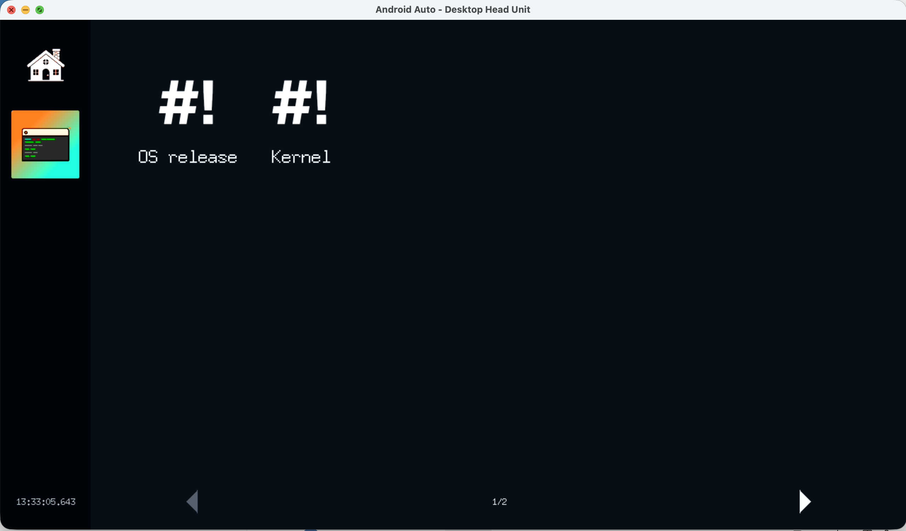
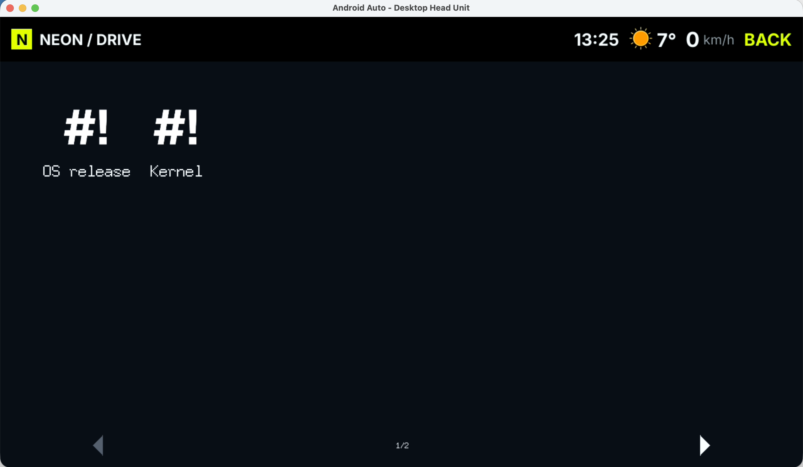
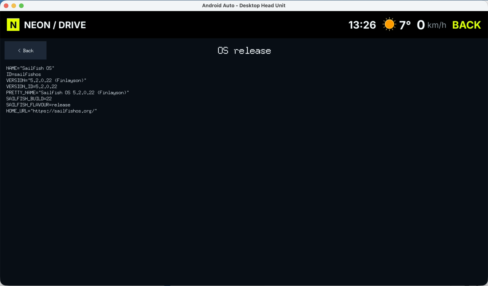

# Cargadgetd shells

Shell script runner for cargadgetd.

Looking for cargadgetd? [Click here to go to main project repo](https://github.com/mrcyjanek/cargadgetd)

## Screenshots

|  | |
|:-:|:-:|
|  |  |

Shells visible above:

- [Basic](https://github.com/MrCyjaneK/cargadgetd_shell_basic)
- [Neon](https://github.com/MrCyjaneK/cargadgetd_shell_neon)

<a href="https://www.flaticon.com/free-icons/terminal" title="terminal icons">Terminal icons created by fajarestuu - Flaticon</a>
